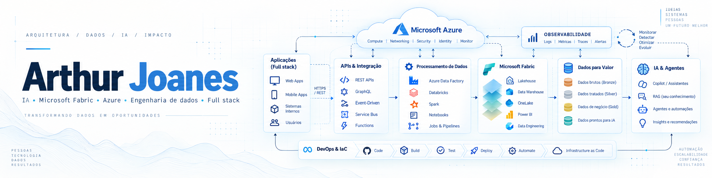

[Português](README.md) · [LinkedIn](https://www.linkedin.com/in/arthur-joanes-6a2967373/) · [Email](mailto:arthurjoanes@hotmail.com)

I'm a **mid-level software developer** with over three years of software development experience. I work on Python APIs, web applications, data engineering and applied AI for retail operations.

My work connects ERP integrations to the interfaces used by teams, including access permissions, data quality and monitoring applications in production.

## Professional experience

- **AI for store data queries.** I developed Sol, a WhatsApp assistant using Meta's official API, with permission checks, data isolation between stores and response verification.
- **Financial automation.** I integrated an ERP with WhatsApp using Python, FastAPI and Next.js to automate payment reminders, freeing one person from a manual routine that took their entire workday.
- **Data at scale.** I maintain Microsoft Fabric pipelines for a platform with **over 3.8 billion records**, serving **more than 800 stores across 23 Brazilian states**. I implemented checks that block incomplete data from publication and allow periods to be reprocessed without duplicating records.
- **AI observability.** I developed a dashboard with FastAPI, Next.js and KQL in Azure Log Analytics to investigate failures and track response cost and quality.

## Selected projects

These are personal demonstrations using synthetic data. Each repository documents how to run it, technical decisions and implementation limits.

### [EvidenceDesk](https://github.com/arthurjoanes/evidencedesk)

Investigates discrepancies between orders and payments using verifiable sources, optional AI drafts and review by another person before approval. The analysis workflow also works without AI generation.

**Python · FastAPI · PostgreSQL · Next.js · Optional Azure OpenAI**

### [Gestão de Recebíveis](https://github.com/arthurjoanes/gestao-recebiveis)

An accounts receivable application with CSV imports, payment recording without duplication and recovery of interrupted jobs. Reminders use a simulated provider, distinguishing delivery attempts from confirmed delivery.

**Python · FastAPI · PostgreSQL · Next.js · Docker**

### [Varejo Data Pipeline](https://github.com/arthurjoanes/varejo-data-pipeline)

A sales data pipeline with coverage validation, revision handling and consistent publication of indicators. Blocked or failed batches preserve the previous publication, with local failure and recovery scenarios.

**Python · PySpark · Delta Lake · SQL · Docker**

Also in my portfolio:

- [**Loja Assistente**](https://github.com/arthurjoanes/loja-assistente) — sales queries in Portuguese, with store-level authorization, backend calculations and optional AI.
- [**API Sentinel**](https://github.com/arthurjoanes/api-sentinel) — a B2B API with organization isolation, shared quotas and observability for failures and recovery.
- [**ContainerOps**](https://github.com/arthurjoanes/containerops) — an API and worker operations lab covering job recovery, backup, restore and rollback.

## Technologies I use at work

| Area | Tools |
| --- | --- |
| Backend | Python, FastAPI, Pydantic, SQL |
| Web applications | TypeScript, React, Next.js |
| Data engineering | Microsoft Fabric, PySpark, OneLake, Delta Lake, Power BI |
| Cloud, AI and observability | Azure Container Apps, Azure OpenAI, Azure Log Analytics, KQL |
| Quality and delivery | pytest, Docker, CI/CD |
| Integrations | Meta WhatsApp Cloud API, ERP integration |

## Education and contact

I'm studying **Computer Science at Rede de Ensino Doctum**, currently in my eighth semester. Based in **Raul Soares, Minas Gerais, Brazil**, I'm interested in fully remote opportunities in software development, applied AI and data.

Connect with me on [LinkedIn](https://www.linkedin.com/in/arthur-joanes-6a2967373/) or email **[arthurjoanes@hotmail.com](mailto:arthurjoanes@hotmail.com)**.
