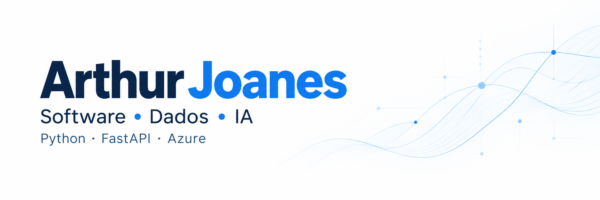
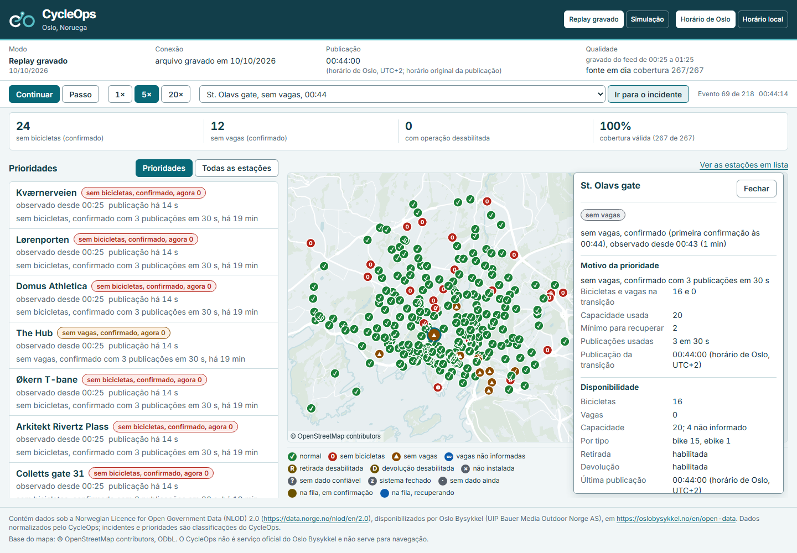
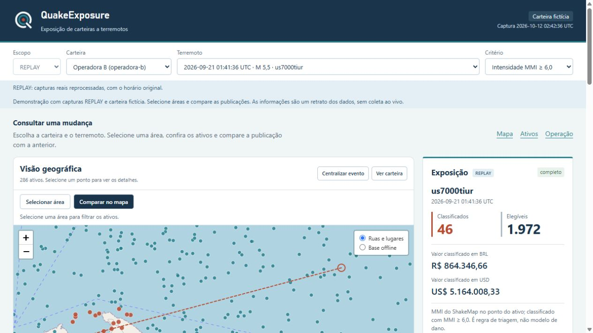
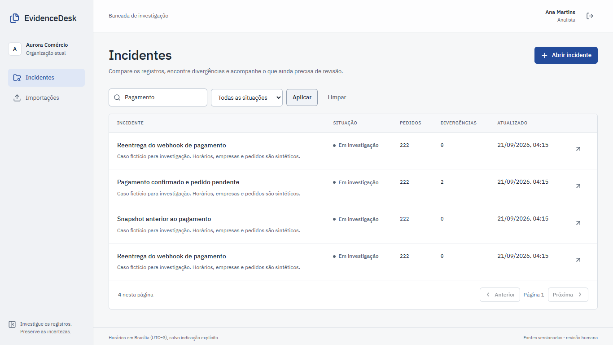

  <a href="README.en.md">English</a> &nbsp; · &nbsp;
  <a href="https://www.linkedin.com/in/arthur-joanes-6a2967373/">LinkedIn</a> &nbsp; · &nbsp;
  <a href="mailto:arthurjoanes@hotmail.com">E-mail</a>

Sou **desenvolvedor de software pleno**, com mais de três anos em desenvolvimento. Trabalho com APIs em Python, aplicações web, engenharia de dados e IA aplicada a operações de varejo.

Meu trabalho vai da integração com o ERP à interface usada pela equipe, passando por permissões de acesso, qualidade dos dados e acompanhamento das aplicações em produção.

## Projetos em destaque

Projetos pessoais com dados abertos ou sintéticos. Cada repositório traz as fontes, as instruções de execução e as decisões técnicas.

### CycleOps

Disponibilidade de bicicletas em Oslo, com mapa, histórico e priorização de incidentes. A demo reproduz uma **gravação real do feed GBFS**; o ambiente local permite coleta ao vivo.

**[Abrir demo](https://arthurjoanes.github.io/cycleops/)** &nbsp; · &nbsp; [Ver repositório](https://github.com/arthurjoanes/cycleops)

`Python` `FastAPI` `PostgreSQL` `React` `TypeScript` `MapLibre`

### QuakeExposure

Exposição de uma **carteira fictícia** a terremotos, com eventos e ShakeMap do USGS e comparação entre publicações. A demo usa um **snapshot calculado**; o ambiente local inclui atualização da carteira via CDC.

**[Abrir demo](https://arthurjoanes.github.io/quake-exposure/)** &nbsp; · &nbsp; [Ver repositório](https://github.com/arthurjoanes/quake-exposure)

`Python` `FastAPI` `PostGIS` `Kafka` `Debezium` `TypeScript` `Leaflet`

### EvidenceDesk

Investigação de divergências entre pedidos e pagamentos, reunindo fontes verificáveis, rascunhos opcionais de IA e revisão por outra pessoa antes da aprovação. O fluxo de análise também funciona sem geração por IA.

**[Ver repositório e execução local](https://github.com/arthurjoanes/evidencedesk)**

`Python` `FastAPI` `PostgreSQL` `Next.js` · Azure OpenAI opcional

<strong>Mais projetos: dados, APIs e automação</strong>

- [**Gestão de Recebíveis**](https://github.com/arthurjoanes/gestao-recebiveis) — contas a receber com importação CSV, pagamentos sem duplicação e recuperação de tarefas; lembretes por provedor simulado, distinguindo tentativa de envio e entrega confirmada.
- [**Varejo Data Pipeline**](https://github.com/arthurjoanes/varejo-data-pipeline) — PySpark e Delta Lake para validar cobertura, tratar revisões e publicar indicadores; lotes bloqueados ou falhos preservam a publicação anterior.
- [**Loja Assistente**](https://github.com/arthurjoanes/loja-assistente) — consultas de vendas em português, com autorização por loja, cálculo no backend e IA opcional.
- [**API Sentinel**](https://github.com/arthurjoanes/api-sentinel) — API B2B com isolamento por organização, quotas compartilhadas e observabilidade de falhas e recuperação.
- [**ContainerOps**](https://github.com/arthurjoanes/containerops) — laboratório de operação de API e worker, com recuperação de tarefas, backup, restauração e rollback.

## Experiência na prática

- **IA para consultar dados das lojas.** Desenvolvi a Sol, assistente no WhatsApp pela API oficial da Meta, com validação de permissões, isolamento de dados entre lojas e verificação das respostas.
- **Automação financeira.** Integrei ERP e WhatsApp com Python, FastAPI e Next.js para automatizar a cobrança de boletos, liberando uma pessoa de uma rotina manual que ocupava o dia inteiro.
- **Dados em escala.** Cuido dos pipelines no Microsoft Fabric de uma plataforma com **mais de 3,8 bilhões de registros**, que atende **mais de 800 lojas em 23 estados**. Implementei validações que bloqueiam dados incompletos e permitem reprocessar períodos sem duplicar registros.
- **Visibilidade sobre a IA.** Desenvolvi um painel com FastAPI, Next.js e KQL no Azure Log Analytics para investigar falhas e acompanhar custo e qualidade das respostas.

<strong>Tecnologias que uso no trabalho</strong>

| Área | Ferramentas |
| --- | --- |
| Backend | Python, FastAPI, Pydantic, SQL |
| Aplicações web | TypeScript, React, Next.js |
| Engenharia de dados | Microsoft Fabric, PySpark, OneLake, Delta Lake, Power BI |
| Cloud, IA e observabilidade | Azure Container Apps, Azure OpenAI, Azure Log Analytics, KQL |
| Qualidade e entrega | pytest, Docker, CI/CD |
| Integrações | WhatsApp Cloud API da Meta, integração com ERP |

## Formação e contato

Curso **Ciência da Computação na Rede de Ensino Doctum**, com o 8º período em andamento. Moro em **Raul Soares, MG**, e tenho interesse em oportunidades 100% remotas em desenvolvimento de software, IA aplicada e dados.

[Vamos conversar pelo LinkedIn](https://www.linkedin.com/in/arthur-joanes-6a2967373/) ou pelo e-mail **[arthurjoanes@hotmail.com](mailto:arthurjoanes@hotmail.com)**.
